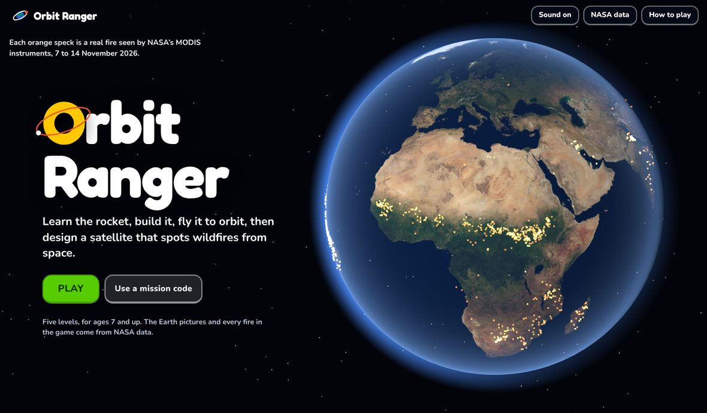
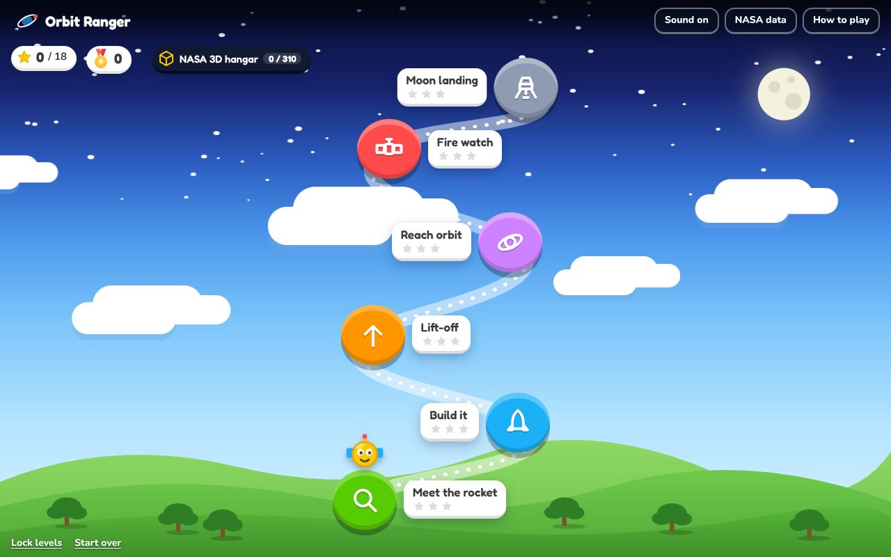
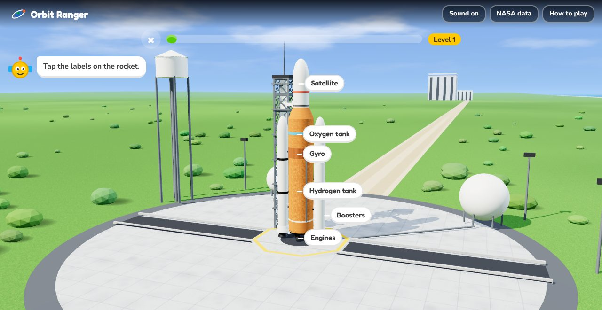
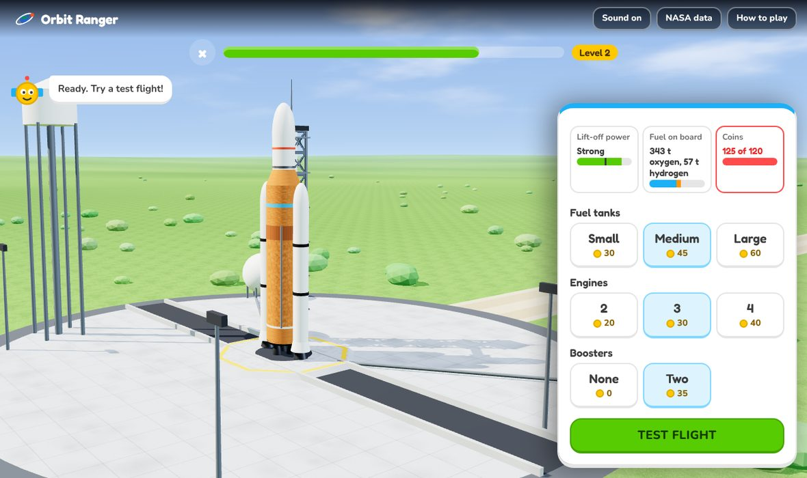
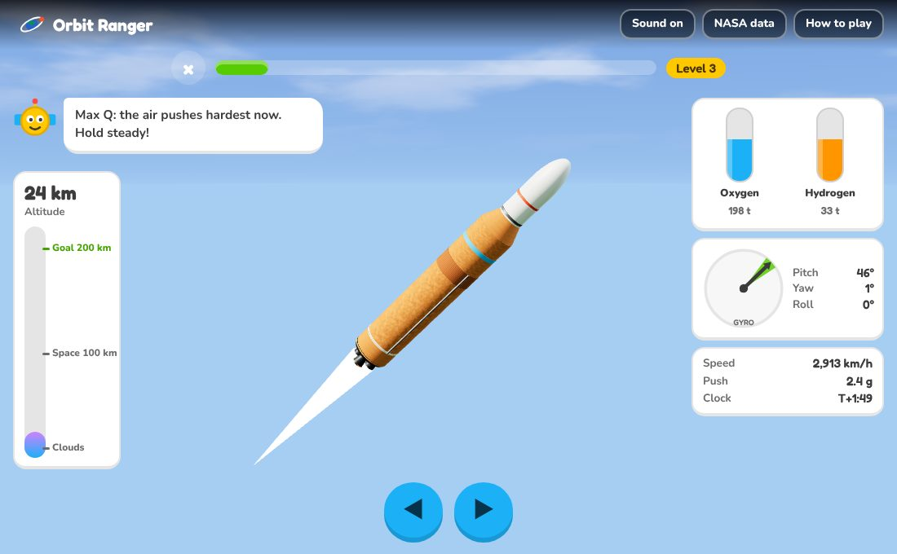
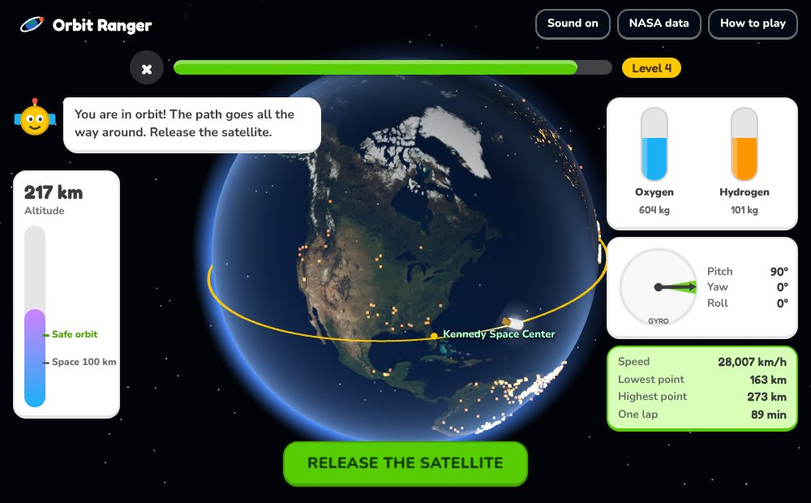
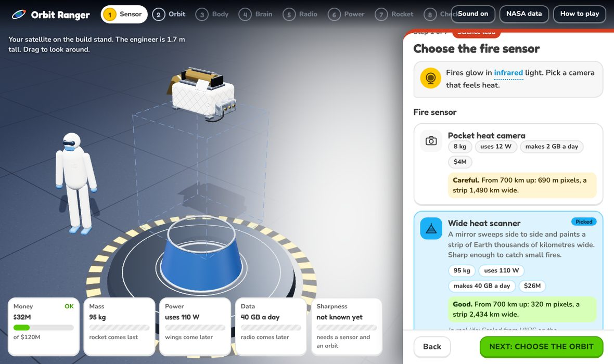
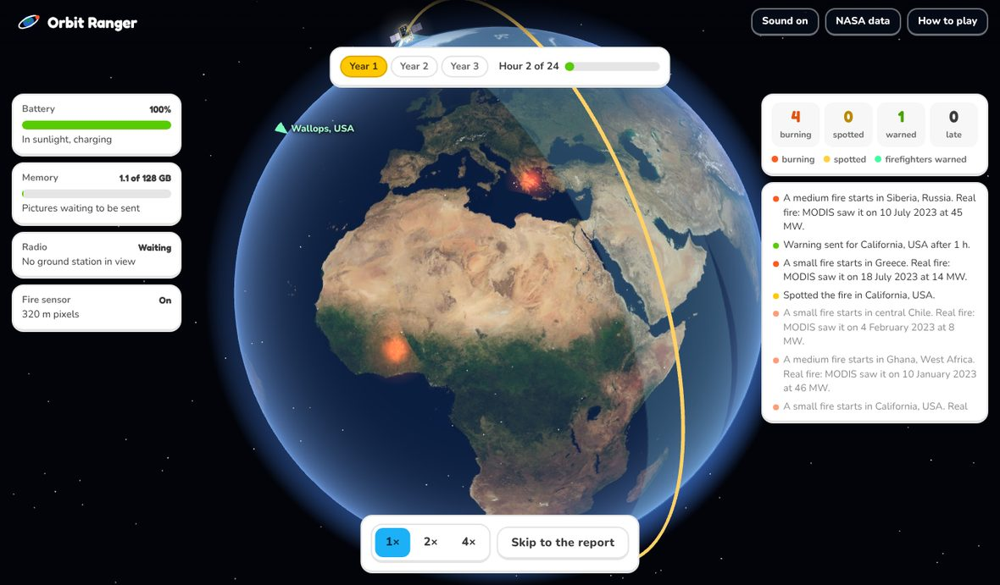
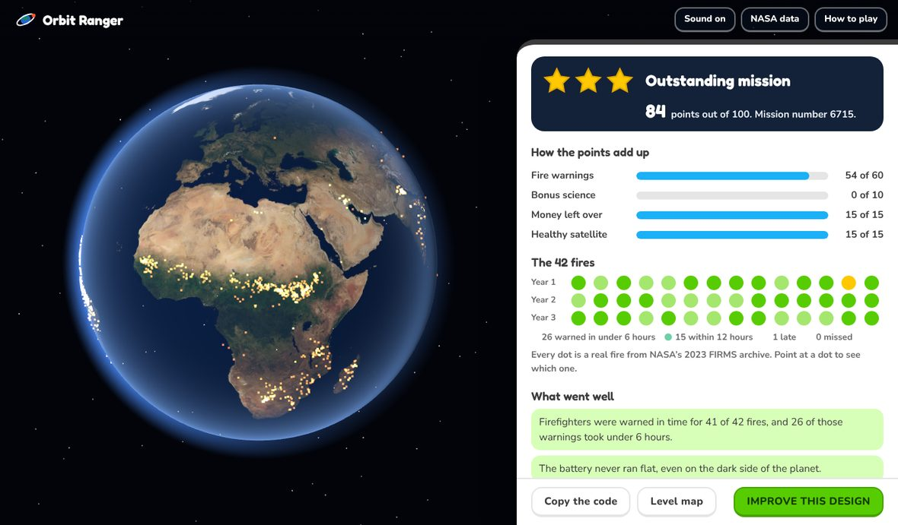

# Orbit Ranger

A 3D space mission game you play in levels. Meet the rocket, build it, fly it
to space, reach orbit, and then design your own satellite that spots wildfires
using real NASA fire data.

Built for the 2026 NASA Space Apps Challenge, **Space Mission Design Game**.
For ages 7 and up. Levels 1 to 4 take a few minutes each; level 5 is a
15-minute mission for 1 to 4 players.



## Run it

Unzip the folder and double-click `index.html`. There is nothing to install
and it works offline.

If your browser is strict about local files, serve the folder instead:

```sh
python3 -m http.server 8080     # then open http://localhost:8080
```

It needs a browser with WebGL 2 (any current Chrome, Edge, Firefox or Safari).
It was developed and tested in Chromium, at desktop and phone sizes.

## The five levels

The map climbs from the grass, through the clouds, into space. Levels unlock
in order, each is worth up to three stars, and progress is saved in the
browser. One tap on the map starts a level, the quiz moves on by itself, and
"Next level" goes straight into the next one. Pip, the little guide, says
what to do in a few words.



| Level | What you do | What you learn |
| --- | --- | --- |
| 1. Meet the rocket | Tap the labels on a 3D rocket to x-ray each of 6 parts, with numbered call-outs, then answer 3 quick questions | What the tanks, engines, boosters, upper stage, nose cone and gyros are for |
| 2. Build it | Drag fuel tanks, engines and boosters onto their glowing slots, then run a test flight | Push must beat weight to lift off; fuel decides how fast you end up; everything costs coins |
| 3. Lift-off | Launch, steer with the arrows to keep the gyro needle in the green, drop the empty boosters | Why rockets tip over sideways as they climb, Max Q, staging, where space begins |
| 4. Reach orbit | Coast to the top of the arc, hold the button to burn sideways until the path closes, release the satellite | An orbit is about speed, not height: about 28,000 km/h sideways |
| 5. Fire watch | Seven design choices, a Go/No-go check, launch, three years of real fires, and a report | Trading mass, power, data, money and sharpness against each other |









### Drag, fail, collect

- **Drag and drop.** In levels 2 and 5 every part is dragged onto a labelled slot that glows while you carry it. A tap shows a hand making the move; on touch screens press and hold to lift a part; Enter or Space picks from the keyboard.
- **Pip reacts.** The guide cheers, worries or gasps as the design and the flight change.
- **What went wrong.** A failed flight plays a short cartoon of the cause, with one "Try this" button.
- **Badges and NASA mission cards.** Twelve badges reward different ways of winning, and ten cards of real NASA missions unlock as you play. The map's medal button opens the collection.

### Gauges in the flying levels

- **Altitude meter** with marks for the clouds, the edge of space (100 km) and the goal.
- **Oxygen and hydrogen tanks**, in tonnes, plus the boosters' fuel.
- **Gyro**: a needle for the rocket's tilt, a green wedge for where it should
  point, and pitch, yaw and roll readings.
- **Data**: speed, g-force and the mission clock; in level 4 also the lowest
  and highest point of the orbit and the time for one lap.

## The look

The layout borrows ideas from how Duolingo and Candy Crush guide players: a
path of levels, one small thing to do at a time, instant right-or-wrong
feedback, stars, bright colours and chunky buttons that press down. All the
artwork, the guide character and the code are original to this project.

## How it answers the challenge

| The challenge asks for | In Orbit Ranger |
| --- | --- |
| Design, manage and simulate a complete mission | Levels 2 to 5: build the rocket, fly it, reach orbit, then design, launch and run a satellite mission |
| Define a mission objective first | Level 5's briefing sets five goals before any hardware is chosen |
| Pick spacecraft parts, instruments, orbit and launch vehicle | Level 2 (rocket) and the seven steps of level 5 (satellite, orbit, rocket) |
| Manage budget, mass, power, data, communications, lifetime | Coins and lift-off power in level 2; five live gauges, a Go/No-go check and a three-year flight in level 5 |
| Every decision has a consequence | The rocket you build in level 2 is the one you fly in levels 3 and 4; every card in level 5 shows a line worked out for your own design |
| No single perfect solution | Several rockets pass level 2 at different prices; in level 5 lean, bonus-science and small-satellite designs all fly with different strengths |
| Check that mass and orbit suit the rocket | The computer test in level 2; blocking checks at Go/No-go in level 5 |
| Up to four players with roles, and negotiation | Level 5: four consoles shared between the players, a shared budget, a team huddle, and every console must press go |
| Accessible to different levels of knowledge | Levels start with tapping and a quiz and end with a full design problem; four difficulty settings in level 5 |
| Explain concepts simply, and say why | Pip's hints, tappable glossary words, feedback after every answer, "In real life" notes |
| Feedback, scoring, post-mission analysis | Stars on every level; a 100-point score and a written debrief in level 5 |
| Random events, sandbox, save and share | Four surprises, a sandbox setting, mission codes and saved progress |

## What is really simulated

**Rocket flight (levels 2 to 4), in `js/flight.js`.** The rocket is a small
cousin of NASA's Space Launch System: a core stage burning liquid hydrogen
with liquid oxygen, optional solid boosters, and a small upper stage. Motion
is worked out around a round Earth with gravity, thrust that grows as the air
thins, air drag, the mass lost as fuel burns, and the free sideways speed from
Earth's spin at Kennedy Space Center. A rocket that is too heavy really does
sit on the pad, and one with too little fuel really does fall back.

**The satellite mission (level 5), in `js/sim.js`.** The satellite flies its
real orbit in half-minute steps while the Earth turns underneath:

- **Fires.** Each fire sits where NASA's MODIS really saw a fire in 2023, and
  its size class comes from the heat MODIS measured.
- **Sight.** A fire is spotted when it is inside the sensor's strip and the
  pixels are small enough.
- **Power.** Solar wings charge the battery in sunlight; Earth's shadow drains it.
- **Data.** Pictures fill the memory and leave only while a ground station can
  see the satellite.
- **Warnings.** A warning counts when it reaches the ground.

Simplified on purpose: tank and booster sizes are scaled down, steering in
level 3 is one needle, level 5 flies three sample days instead of 1,095, and
prices are scaled to make a playable budget.

## NASA data in the game

The Earth and every fire in the game come from NASA. An in-game "NASA data"
button shows the same list.

| What you see | NASA source | How it is used |
| --- | --- | --- |
| The 42 fires in each level 5 mission | **NASA FIRMS**, MODIS Collection 6.1 active-fire archive for 2023 (Terra and Aqua), 12 country files | `tools/build-fires.py` picks nine real fires for each of 14 zones by measured fire radiative power |
| The specks on the globe, and the fires counted at the end of level 4 | **NASA FIRMS**, MODIS global 7-day file (7 to 14 November 2026) | Every confident detection, thinned to about 1,600 points |
| Earth by day | **NASA GIBS**, layer `BlueMarble_NextGeneration` (August 2004) | Worldview snapshot service, 4096 × 2048 |
| Earth by night | **NASA GIBS**, layer `VIIRS_Black_Marble` (2016, Suomi NPP) | Worldview snapshot service, resized to 2048 × 1024 |
| Rocket engines | NASA's RS-25 (452 s, 2,279 kN in vacuum, six parts oxygen to one part hydrogen) and RL10 upper-stage engine; the stage layout follows the Space Launch System | Constants at the top of `js/flight.js` |
| Launch site | Kennedy Space Center | Latitude, longitude and spin speed in `js/flight.js` |
| Ground stations | NASA's Near Space Network: Wallops, McMurdo, Fairbanks, White Sands | Coordinates in `js/data.js` |
| Sensors and orbits | VIIRS on Suomi NPP, the imager on GOES-R, the Space Station's orbit, GOES-East | Numbers in `js/data.js`, checked by the tests |

Sources:

- FIRMS: https://firms.modaps.eosdis.nasa.gov/
- GIBS: https://www.earthdata.nasa.gov/engage/open-data-services-software/earthdata-developer-portal/gibs-api

**Not NASA data, and labelled as a game model:** tank and booster sizes,
coins, the prices and masses of satellite parts, which pixel size catches
which fire, the hour each fire starts, the surprises and the scoring. The only
non-NASA files are tools rather than data: three.js and two open-licence fonts.

**The challenge's Resources tab.** The Space Apps website blocks automated
readers, so the Resources tab for this challenge could not be read while
building the game. The sources above were chosen independently. If the tab
lists specific resources, check them against this table and add any that are
missing.

To refresh the fire data, download the files named at the top of
`tools/build-fires.py` into a folder and run
`python3 tools/build-fires.py <folder>`.

## The 3D models

Everything is built in code, with no model files to download. The launch site
has a sky with drifting clouds that thins into space as you climb, textured
grass with bushes, the sea to the east, a concrete pad with a flame trench
and crawlerway, a lattice service tower, fuel spheres, a water tower and soft
shadows. The rocket is put together from the parts you pick. The satellite uses physically based
materials: crinkled gold insulation foil, solar cells under cover glass,
mirror-tile radiators, coated lenses, rounded machined edges, bolts and cable
runs, lit by a studio reflection map and a soft shadow-casting light.

On a slow computer the game lowers its own quality (fewer pixels first, then
no shadows) to stay smooth. Add `?quality=high` to the address to keep full
quality.

## Team play

Level 5 can be played by 2 to 4 players on one screen. The four jobs (science
lead, flight navigator, spacecraft engineer, data officer) are shared out,
each step shows whose turn it is, everyone spends from the same budget, and
every console has to press its own go button before launch.

## Project layout

```
index.html              the page; plain scripts so it runs from a double-click
css/style.css           all styling
js/flight.js            rocket physics for levels 2 to 4
js/data.js              level 5: every part, orbit, rocket, fire zone and line of teaching text
js/physics.js           level 5: orbit geometry (period, shadow, coverage, station contact)
js/model.js             level 5: design checker, Go/No-go checks, mission codes
js/sim.js               level 5: the mission simulation, scoring and debrief
js/audio.js             sound effects made with the Web Audio API
js/scene/engine.js      renderer, camera, stars, labels, quality step-down
js/scene/earth.js       the globe, coverage paint, orbit rings, flight paths, fires, stations
js/scene/satellite.js   the detailed satellite model
js/scene/rocket.js      launch pad, the build-it-yourself rocket, flames and smoke
js/scene/views.js       which scene shows when
js/ui/levels.js         the level map and levels 1 to 4
js/ui/app.js            level 5 screens and game flow
js/ui/widgets.js        icons, gauges, card lines
assets/nasa-fires.js    real NASA FIRMS fire detections
assets/                 NASA GIBS Earth images, fonts
vendor/three.min.js     three.js r149
tests/run-tests.js      40 tests, no framework
tools/                  balance tool, fire-data builder, texture packer
```

`flight.js`, `data.js`, `physics.js`, `model.js` and `sim.js` have no browser
code in them, so they also run in Node.

## Tests and tools

Needs Node 18 or newer. There are no dependencies to install.

```sh
node tests/run-tests.js          # rocket flight, orbit physics, NASA data, design checker, mission
node tools/balance.js engineer   # level 5 scores for a set of reference designs
```

To change level 5, edit `js/data.js`. To change the rocket parts or the level 2
budget, edit the tables at the top of `js/flight.js`; the tests check that at
least three different rockets still pass.

## Accessibility

- Everything works from the keyboard: arrow keys steer in level 3, the space
  bar burns in level 4, and on the 3D view arrow keys turn it and + and − zoom.
- Status is never colour alone: answers, meters and checks carry words or symbols.
- Picks, answers and results are announced to screen readers.
- With "reduce motion" switched on in the system settings, camera glides,
  shake and bouncing are removed.

## Ideas for next

More levels (a Moon landing, docking), a constellation of several satellites,
online team play, and translations.

## Licence

Code and text: MIT (`LICENSE`). NASA data and imagery, three.js and the fonts
keep their own terms; see `CREDITS.md`.
